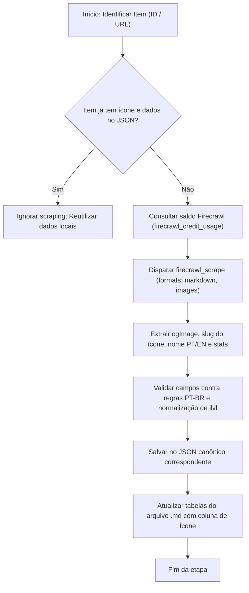

# PROTOCOLO DE EXTRAÇÃO FIRECRAWL — WOWHEAD (WORLD OF WARCRAFT)

> **Documento Normativo de Coleta e Enriquecimento de Dados**  
> **Destinatário:** Qualquer Agente ou Inteligência Artificial atuando no projeto WoW Calculator.  
> **Escopo:** World of Warcraft: Midnight — Patch 12.1.5 (*A Maldição de Ula'tek*), Temporada 2 e expansões vigentes.  
> **Objetivo:** Estabelecer o procedimento padrão para utilizar o Firecrawl na extração máxima de dados técnicos, estruturais e visuais (incluindo imagens de ícones oficiais) do Wowhead, sem alucinações, sem perda de créditos e em perfeita sintonia com a base do projeto.

---

## 1. Princípios Mestres e Regras do Contrato

Qualquer IA que execute operações de raspagem via Firecrawl neste projeto deve obedecer estritamente às regras de integridade de [`00-INSTRUCOES-IA.md`](00-INSTRUCOES-IA.md:1):

1. **Prioridade Absoluta ao Nome Oficial PT-BR:**
   - A extração deve sempre buscar o nome em Português do Brasil a partir do Wowhead PT (`https://www.wowhead.com/pt/item=<id>`).
   - O nome original em inglês (*locale 0*) deve ser mantido como identificador secundário entre parênteses ou no campo `nome_en` para conciliação com SimC/Raidbots.
   - **Proibição Expressa:** Nunca traduza nomes por conta própria. Copie estritamente a grafia do tooltip e do cabeçalho oficial.

2. **Zero Alucinação Numérica:**
   - Não infira valores de atributos, taxas de dano por segundo (DPS), velocidade de ataque ou números de efeitos de berloque.
   - Todo número registrado deve ser extraído diretamente da página do item ou do tooltip oficial correspondente à trilha de item level analisada.

3. **Respeito aos Créditos e Idempotência:**
   - O Firecrawl consome créditos por requisição. Antes de raspar qualquer item, verifique se os dados e o ícone já não se encontram catalogados no JSON local.
   - Toda rotina deve ser idempotente: executar duas vezes não deve duplicar registros nem quebrar schemas existentes.

---

## 2. Especificação Técnica do Ícone Wowhead

A captura de imagens de ícones de itens e equipamentos é elemento central para interfaces visuais, documentação Markdown e renderizações no aplicativo.

### 2.1 Padrão da CDN da Zamimg
O Wowhead hospeda todos os seus ícones na CDN oficial `wow.zamimg.com`. Cada ícone possui um slug identificador (ex.: `inv_knife_1h_zuljin_d_01`, `inv_offhand_1h_outdooramaniloa_c_01`).

A partir do `slug` extraído, a URL do ícone é montada conforme as dimensões necessárias:

| Resolução | Dimensões | Formato | Estrutura da URL | Uso Recomendado |
| :---: | :---: | :---: | :--- | :--- |
| **Large** | 56×56 px | `.jpg` | `https://wow.zamimg.com/images/wow/icons/large/<slug>.jpg` | Fichas de item, cards detalhados, modais |
| **Medium** | 36×36 px | `.jpg` | `https://wow.zamimg.com/images/wow/icons/medium/<slug>.jpg` | Tabelas de loot em Markdown, listas |
| **Small** | 18×18 px | `.jpg` | `https://wow.zamimg.com/images/wow/icons/small/<slug>.jpg` | Badges compactos, tooltips inline |
| **Tiny** | 15×15 px | `.gif` | `https://wow.zamimg.com/images/wow/icons/tiny/<slug>.gif` | Árvores densas de talentos |

### 2.2 Onde o Firecrawl Encontra o Ícone na Página do Wowhead

Ao submeter a URL `https://www.wowhead.com/pt/item=<id>` ao `firecrawl_scrape`, o Firecrawl entrega o ícone em quatro posições confiáveis do payload:

1. **Metadados OpenGraph (`metadata.ogImage` ou `metadata["og:image"]`):**
   - É o caminho mais direto e confiável. O Wowhead injeta a imagem oficial do ícone diretamente na tag `og:image`.
   - Exemplo retornado: `"https://wow.zamimg.com/images/wow/icons/large/inv_knife_1h_zuljin_d_01.jpg"`.
2. **Metadados Twitter Card (`metadata["twitter:image"]`):**
   - Espelha com fidelidade idêntica o link em alta resolução da CDN.
3. **Corpo Markdown (`markdown`):**
   - No bloco de resumo rápido do item (*Quick Facts*), o Wowhead lista o ícone no formato:
     `- Ícone: [~~~~ inv_knife_1h_zuljin_d_01](https://www.wowhead.com/pt/icon=...)`
   - Expressão regular para captura do slug: `/Ícone:\s*\[~~~~?\s*([a-zA-Z0-9_\-]+)\]/i`.
4. **Vetor de Imagens (`images`):**
   - Lista todas as URLs de imagem encontradas na página. Filtrar por `img.includes("images/wow/icons/large/")`.

### 2.3 Expressão Regular para Extração do Slug a partir da URL
```javascript
function extrairIconeSlug(urlOuTexto) {
    if (!urlOuTexto) return null;
    const matchUrl = urlOuTexto.match(/icons\/(?:large|medium|small)\/([a-zA-Z0-9_\-]+)\.(?:jpg|png|webp)/i);
    if (matchUrl) return matchUrl[1];
    const matchMd = urlOuTexto.match(/Ícone:\s*\[~~~~?\s*([a-zA-Z0-9_\-]+)\]/i);
    if (matchMd) return matchMd[1];
    return null;
}
```

---

## 3. Protocolo de Execução com Firecrawl

### 3.1 Parâmetros Obrigatórios para `firecrawl_scrape`

Para obter o máximo de informações em uma única chamada (1 crédito), envie os seguintes argumentos:

```json
{
  "url": "https://www.wowhead.com/pt/item=<ITEM_ID>",
  "formats": ["markdown", "images"],
  "onlyMainContent": false,
  "proxy": "basic"
}
```

- **Por que `onlyMainContent: false`?** Porque o menu de resumo lateral (*infobox / quick facts*) contém o nome em inglês, o custo de reparo, o slot exato e o link para o modelo 3D. Se restrito ao corpo principal, esses metadados podem ser podados.
- **Por que `formats: ["markdown", "images"]`?** Fornece o texto completo estruturado do tooltip (atributos, efeitos, requisitos) e a lista exata de URLs de mídia sem a sobrecarga de bytes do HTML bruto.

### 3.2 Campos Essenciais a Extrair de Cada Item

Toda extração deve estruturar o registro do item com os seguintes dados consolidados:

```json
{
  "item_id": 275070,
  "nome_pt": "Navalha de Lumineira Afiada",
  "nome_en": "Sharpened Lightwood Slasher",
  "qualidade": "Épico",
  "slot": "Uma Mão",
  "subtipo": "Adaga",
  "icone": "inv_knife_1h_zuljin_d_01",
  "icone_url": "https://wow.zamimg.com/images/wow/icons/large/inv_knife_1h_zuljin_d_01.jpg",
  "icone_url_media": "https://wow.zamimg.com/images/wow/icons/medium/inv_knife_1h_zuljin_d_01.jpg",
  "ilvl_referencia": 341,
  "track": "Ascendente Forjado com Peçonha: Mito",
  "atributo_primario": "Agilidade",
  "stats_primarios": {
    "Agilidade": 101,
    "Vigor": 2118
  },
  "stats_secundarios": {
    "Critico": 60,
    "Aceleracao": 44
  },
  "arma_dados": {
    "dano_min": 154,
    "dano_max": 257,
    "velocidade": 1.80,
    "dps": 114.2
  },
  "efeito": {
    "tipo": "Equipar",
    "spell_id": 1296732,
    "descricao_pt": "Seus ataques e habilidades de dano bem-sucedidos têm chance de calcinar o alvo, causando 6322 de dano Sagrado."
  },
  "origem": {
    "tipo": "Masmorra Mítico+",
    "dungeon_pt": "Altar das Presas",
    "dungeon_en": "Altar of Fangs",
    "chefe": "Zul'jan"
  },
  "wowhead": "https://www.wowhead.com/pt/item=275070"
}
```

---

## 4. Tratamento de Peculiaridades do Wowhead PT-BR

Durante a extração, atente-se às seguintes anomalias já documentadas no histórico do projeto:

1. **Pegadinha do "Atributo não utilizado" (Versatilidade):**
   - Em certos itens traduzidos no Wowhead PT, o atributo Versatilidade pode surgir como `??? Atributo não utilizado (+N)`.
   - **Ação corretiva:** Toda vez que essa linha for encontrada no markdown ou no texto do tooltip, converta automaticamente para `Versatilidade: N`.
2. **Itens Homônimos em Slots Diferentes:**
   - Exemplo real: **Dragonas do Pisa-piras** (`272236` é ombro de tecido; `272225` é capa).
   - **Ação corretiva:** O `item_id` numérico é sempre a chave primária única imutável. Nunca use o nome isoladamente como chave de mapa.
3. **Variações de Ilvl e Bônus:**
   - O Wowhead mostra a versão base ou padrão do item caso não haja parâmetros de bônus (`?bonus=...`).
   - Mantenha a normalização pelo teto de referência do catálogo (ex.: Mito 341/334, Herói 328/321, Delve 321), preservando os `stats_oficiais` já auditados.

---

## 5. Padrão de Renderização Visual nos Documentos Markdown (.md)

Para enriquecer os documentos do projeto (`mplus_loot_database.md`, `delve_loot_kindojan.md`, etc.), as tabelas de itens passam a incorporar a coluna de **Ícone** renderizada com HTML semântico ou links de imagem com dimensão controlada:

### Formato de Tabela Padrão (Armas):
```markdown
| Ícone | Item | ID | Tipo | Primário | Secundários | Origem |
| :---: | :--- | :-: | :--- | :--- | :--- | :--- |
|  | **Navalha de Lumineira Afiada** | 275070 | Adaga 1H | ❌ Agilidade | Crítico + Aceleração | Altar das Presas |
|  | **Presa Focal Maléfica** | 273779 | Mão Secundária | ✅ Intelecto | Crítico + Aceleração | Altar das Presas |
```

> **Dica de Renderização:** O uso de `` garante alinhamento vertical perfeito nas tabelas Markdown do GitHub / Antigravity sem quebrar o layout da coluna.

---

## 6. Fluxo de Trabalho Integrado para a IA

Ao receber a instrução de atualizar ou raspar equipamentos com Firecrawl:



---

## 7. Registro de Versionamento do Protocolo

- **Versão 1.0 (06/11/2026):** Criação do protocolo normativo unificado. Definição do pipeline de captura de ícones via CDN Zamimg (`og:image`), extração cirúrgica com `formats: ["markdown", "images"]`, tratamento de especificidades de PT-BR e padronização visual com tags HTML controladas para tabelas Markdown.
